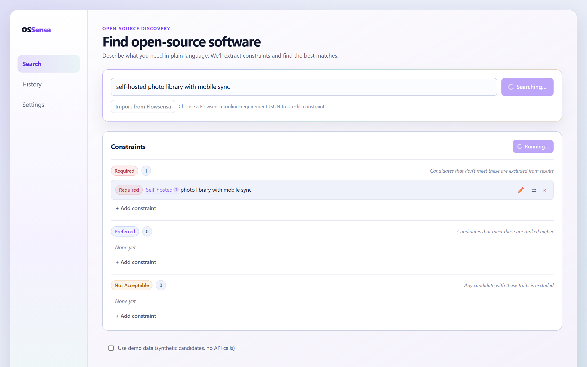

# OSSensa

Describe what you need in plain language; get a ranked, evidence-backed shortlist of open-source software — with every claim traced to its source.

[**Live demo**](https://ossensa.vercel.app)

[](LICENSE)

## Series context

OSSensa appears in [*Dude, Where's My Claude?*](https://henryflowers45.substack.com/p/dude-wheres-my-claude) ([LinkedIn post](https://www.linkedin.com/posts/henry-flowers_fable5-aisovereignty-localai-activity-7480372630135418882-WWUd)), part of the *Looping in the Human* series.



## How discovery works

```
your words → query expansion → source fan-out → identity resolution
           → bounded evidence retrieval → licence gate → ranked top 5
           + a coverage report of what was searched, failed, or skipped
```

Candidates come from GitHub, GitLab, Codeberg, npm, crates.io, Packagist, and Wikipedia, with vulnerability evidence from OSV.dev — all keyless public APIs called from your browser.

## Trust rules

- A candidate is labelled **OSI open source** only when SPDX metadata or a retrieved licence file supports it — AI output can't set it.
- Conflicting claims are shown as conflicts, never silently resolved.
- Every claim carries its source URL, retrieval time, and provenance type; demo data is never substituted for a failed live search.

## Quick start

```bash
npm ci
npm run dev      # browser shell at http://localhost:5173
```

That mode runs browser-accessible adapters and the synthetic demo, but not the server-side evidence fetcher. For the full self-hosted stack:

```bash
set OSSENSA_FETCH_ENABLED=1   # PowerShell: $env:OSSENSA_FETCH_ENABLED = '1'
vercel dev
```

The public demo leaves `/api/fetch` disabled by default. Before enabling it on an internet-facing deployment, add a durable Vercel Firewall rate-limit rule and an outbound-request budget; the in-function limit is only a backstop. Toggle **Demo mode** to explore with synthetic candidates and no API calls. `npm test` runs offline unit tests; `npm run test:e2e` runs Playwright with mocked sources.

## How it's built

A deterministic domain core (constraint matching, ranking) under `src/domain/`, discovery adapters and identity resolution under `src/lib/discovery/`, and an optional SSRF-guarded serverless function (`api/fetch.ts`) that retrieves licence and official-site evidence the browser can't reach. The function validates every redirect and DNS answer and pins the approved address to the outbound socket. Optional AI summaries use your own OpenRouter key, held in session memory only.

## License

[MIT](LICENSE)
